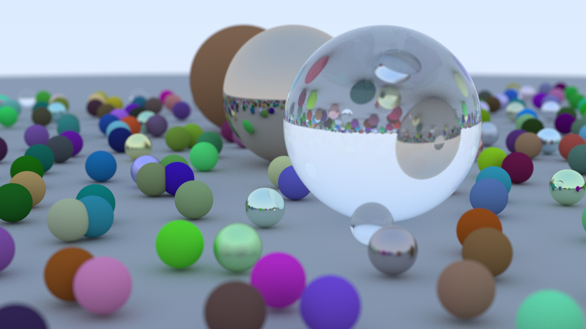

# C++ CPU Ray Tracer

A custom ray tracer built from scratch in C++ (C++17). This project was developed following the excellent book series by Peter Shirley:
* [Ray Tracing in One Weekend](https://raytracing.github.io/books/RayTracingInOneWeekend.html)
* [Ray Tracing: The Next Week](https://raytracing.github.io/books/RayTracingTheNextWeek.html)

## Features
*   Anti-aliasing
*   Diffuse (Lambertian) materials
*   Metal and Dielectric (glass) materials
*   Positionable camera with depth of field
*   Bounding Volume Hierarchies (BVH) for fast rendering
*   Exports images in both `.png` and `.ppm` formats

## Screenshots

*(A scene featuring spheres with different materials)*

## How to Build
1. Ensure you have CMake installed (version 3.10 or higher).
2. Open the project in Visual Studio.
3. Build the `RayTracer` target.
4. Run the executable. The rendered image will be saved in the `output/` folder.

## Ready-to-Run Version
If you do not want to compile the project yourself, go to the **Releases** tab on the right side of this page and download the `.zip` file. Extract it and double-click `RayTracer.exe`.